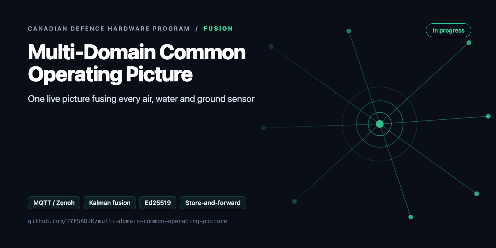
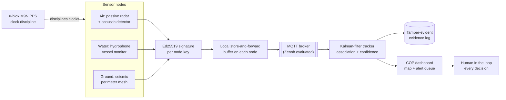

<div align="center">



# Multi-Domain Common Operating Picture

**Fusion layer tying every sensor build together: signed detections over MQTT (Zenoh evaluated), store-and-forward through dead links, one Kalman dashboard.**

[](https://github.com/TYFSADIK/multi-domain-common-operating-picture/actions/workflows/tests.yml)   [](LICENSE) [](https://github.com/TYFSADIK/defence-hardware-program)

[Build guide](docs/project-page.md) · [How it works](#how-it-works) · [Quick start](#quick-start) · [Program hub](https://github.com/TYFSADIK/defence-hardware-program)

</div>

## Overview

Every sensor build in my [defence hardware program](https://github.com/TYFSADIK/defence-hardware-program) ends at the same question: now that a node sees something, where does that knowledge go? This project is the answer. It is the **common operating picture (COP)** that sits above the passive radar node, the hydrophone monitor, the seismic perimeter mesh, and the rest, one pipeline that takes signed detections from all of them, fuses them into tracks, and puts the result in front of a human.

The lesson from Canada's big sensor programs is that sensors are the easy part. The **Arctic Over-the-Horizon Radar** is designed to feed a layered picture of conventional radar, intelligence, airborne, and space-based sensors, the radar is one input, not the product. DRDC's **Northern Watch** demonstration ran into problems with installation, ice, technical issues, and **data management**. The hard part is data management, fusion, and staying alive on bad links. This project is that hard part, and it is where my DevOps background shows: brokers, buffers, signatures, chaos tests, and dashboards are what I do for a living.

The design rules are strict. Nodes **sign every detection** so a consumer can verify who said what. Nodes **buffer locally** and sync when links return, because a sensor that goes silent when the network drops is decoration. Fusion is **time-first**: clocks are disciplined from GNSS PPS before any tracker math is trusted. And the system **cues, it never acts**, every decision is made by a human looking at the dashboard.

## How it works



*Every detection is signed, timestamped by a disciplined clock, buffered through dead links, fused into tracks, and audited, with a human making every decision.*

## Quick start

```bash
pip install -r requirements.txt
python demo.py               # Run T5: node B jumps +47 s mid-run -> still ONE track id, skew flagged, forgery rejected
python -m unittest -v
mosquitto -v & python -m cop.server --keys keys/registry.json   # live, then open http://localhost:8080
```

Real output from the demo, run on simulated data:

```text
track ids used: [1]  (target: exactly one)
clock-skew alerts: 20 on ['seis-B']; forged messages rejected: 1
```

## What's in this repo

| File | Purpose |
|---|---|
| `cop/schema.py` | `Detection` envelope, canonical JSON, Ed25519 sign and verify against a node key registry |
| `cop/clock.py` | **Clock-corruption defence**: per-node latency baseline. Messages off by more than 2 s are flagged, re-timed from broker receive time, and down-weighted, and the baseline never absorbs a step |
| `cop/tracker.py` | 2D constant-velocity Kalman tracker with Mahalanobis gating. Node weight inflates R. Cross-domain fusion by kind |
| `cop/forward.py` | Node-side SQLite outbox that survives reboots. Replays are flagged and **re-signed** |
| `cop/server.py` | MQTT subscriber, then verify, clock check, fuse, and evidence log. HTTP `/api/state`, `/events` (SSE), dashboard |
| `cop/static/index.html` | Range-ring map with tracks coloured by domain, an alert queue, and a rejected-message count |

## What you need

| Category | Item | Notes |
|----|----|----|
| Hardware | Pi 5 + 256 GB NVMe HAT | Broker and tracker host, from the Phase 0 workshop stock |
| Hardware | Homelab Kubernetes cluster | Dashboard host |
| Hardware | u-blox M9N GNSS with PPS | Clock discipline for the aggregator nodes; fusion math trusts nothing without it |
| Hardware | Node radios and storage | ESP32 LoRa nodes and high-endurance SD cards from program stock |
| Software | Mosquitto, chrony, gpsd | Broker with ACLs and persistence; PPS-disciplined time via the PPS refclock |
| Software | Python tracker, Leaflet dashboard | Kalman association and gating; the operator-facing COP |
| Software | Zenoh (evaluated) | Brokerless transport under evaluation as a second-transport experiment |
| Skills | DevOps, Linux, Python | Brokers, buffers, dashboards, chaos testing; hash chains and signature verification |
| Accounts | None | No accounts or licenses required |

## Status

- **Done**: Mosquitto broker with per-node Ed25519 signing and verification; PPS-disciplined clocks via gpsd + chrony on the aggregator nodes; store-and-forward outbox with `tc netem` bench proof; the perimeter COP dashboard live on the homelab cluster with the seismic mesh feeding it; hash-chained evidence log with a working verifier.
- **In progress**: Kalman tracker association and gating tuning across domains; chaos harness scripting for the full T1-T5 failure matrix; audit-log integration of tracker-version records.
- **Next**: hydrophone and passive-radar feeds onto the bus; full published chaos-test metrics (time-to-recover, track continuity) with raw logs; Zenoh brokerless prototype as a second-transport experiment.

| Test | Target | Current status |
|----|----|----|
| T1 baseline | p95 publish-to-map latency in the low seconds on LAN | Harness built; scripted event generator done; baseline runs pending |
| T2 degraded link | Zero lost detections at 40% loss; duplicates deduped at the receiver | Bench proof-of-concept passed informally; scripted runs pending |
| T3 outage | In-order replay with original timestamps; stale-not-silent display | 60 s outage path bench-verified; 10 min and 1 h runs pending |
| T4 failure | Automatic recovery with no audit-chain gaps | Pod-kill path exercised; field-node power-pull runs pending |
| T5 clock corruption | Skew detected and down-weighted; single track ID maintained | Residual-based detection implemented; tuning in progress, not yet run end-to-end |

## Roadmap

- [ ] Node adapters: `acoustic-drone-detector` bearings, `sky-passive-radar-node` plots, `ground-seismic-perimeter-mesh` gateway, `water-...` detections, all to `Detection`
- [ ] Runs T1, T4 (clean link, degraded link via `tc netem`, full outage and recovery, node/service failure) as scripted tests
- [ ] Mosquitto with TLS + per-node client certs, and ACLs so a node can only publish to its own topic
- [ ] Zenoh comparison under `tc netem` loss (latency, recovery time)
- [ ] Forward evidence-log checkpoints to `decision-black-box`

## Related builds

- [**Canadian Defence Hardware Program**](https://github.com/TYFSADIK/defence-hardware-program), the hub page for every sensor node this picture fuses.
- [**DDIL-Proof DevOps**](https://github.com/TYFSADIK/ddil-proof-devops), the store-and-forward and chaos-test patterns the field nodes reuse.
- [**Decision Black Box**](https://github.com/TYFSADIK/decision-black-box), the tamper-evident evidence chain every alert writes to.
- [**Sky: Passive Aerial Early-Warning Node**](https://github.com/TYFSADIK/sky-passive-radar-node), the air-domain data source for the tracker.
- [**Ground: Seismic & Acoustic Perimeter Mesh**](https://github.com/TYFSADIK/ground-seismic-perimeter-mesh), the ground-domain feed already live on the dashboard.

## Learn more

The full build guide, with step-by-step instructions, wiring, troubleshooting and lessons learned, is in [docs/project-page.md](docs/project-page.md). It is also published at [tyfsadik.org](https://tyfsadik.org/work/defence/multi-domain-common-operating-picture.html).

## License

[MIT](LICENSE). Built by [Taki Sadik](https://tyfsadik.org) as part of the self-funded [Canadian Defence Hardware Program](https://github.com/TYFSADIK/defence-hardware-program).
